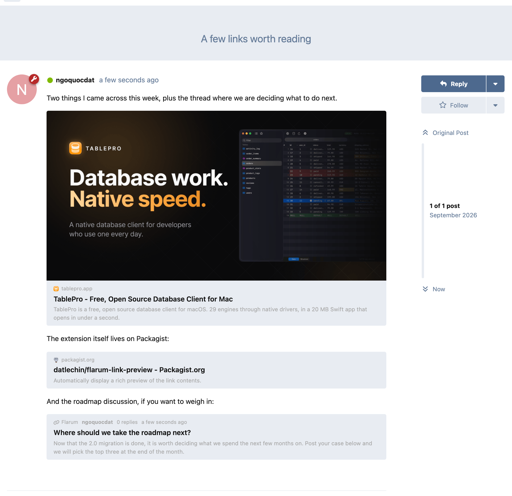
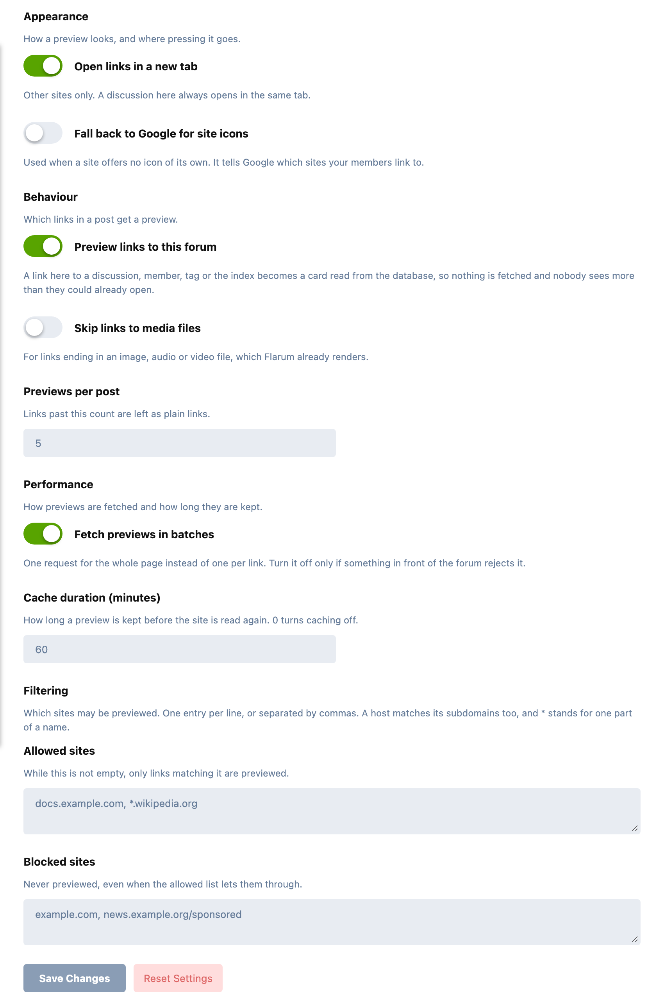

# Link Preview

[](LICENSE.md) [](https://packagist.org/packages/datlechin/flarum-link-preview) [](https://packagist.org/packages/datlechin/flarum-link-preview) [](https://github.com/sponsors/datlechin)

A [Flarum](https://flarum.org) extension. Shows a preview card for links in posts, with the page's title, description and image. Your forum fetches the page itself, so links are not sent to a third-party service.



## Features

- Preview cards for links in posts and private messages.
- A large card with the page's image, or a compact card, depending on the page's metadata.
- Links to your own forum (discussions, users, tags and the index) are previewed from the database, and only show what the reader is allowed to see.
- Allowed and blocked site lists.
- Users can turn off previews in their settings.
- Shows the click count when [Link Clicks](https://github.com/datlechin/flarum-link-clicks) is installed.
- Other extensions can add cards for their own pages.

## Installation

Requires Flarum 2.0 and PHP 8.3 or later.

```sh
composer require datlechin/flarum-link-preview:"*"
```

## Updating

```sh
composer update datlechin/flarum-link-preview:"*"
php flarum migrate
php flarum cache:clear
```

## Configuration



| Setting | Default | Description |
| --- | --- | --- |
| Open links in a new tab | On | Opens links to other sites in a new tab. |
| Fall back to Google for site icons | Off | Uses Google's favicon service when a site has no icon. |
| Preview links to this forum | On | Previews discussions, users, tags and other forum pages from the database. |
| Skip links to media files | Off | Does not preview links to image, audio and video files. |
| Previews per post | 5 | The maximum number of previews in one post. |
| Fetch previews in batches | On | Requests the previews on a page together instead of one request per link. |
| Cache duration (minutes) | 60 | How long a preview is cached. `0` disables caching. |
| Allowed sites | Empty | If set, only these sites are previewed. |
| Blocked sites | Empty | These sites are never previewed. |

### Allowed and blocked sites

Enter one site per line, or separate them with commas.

| Entry | Matches |
| --- | --- |
| `example.com` | `example.com` and its subdomains |
| `example.com/news` | `example.com/news` and the pages under it |
| `*.example.com` | subdomains of `example.com`, but not `example.com` itself |

Entries match the whole host name, so `example.com` does not match `notexample.com`.

## Which links are previewed

- A link is previewed when its text is the URL itself. A link with its own text, such as `[the docs](https://example.com)`, is not.
- If the link is on a line of its own, the card replaces it. Otherwise the card is added at the end of the paragraph.
- A link to a discussion on this forum is only previewed when it is on a line of its own.
- Links in quotes, code blocks and mentions are not previewed.
- If a preview cannot be loaded, the link is left as it is.

## Security

Anyone who can read a post can make your server fetch a URL, so the extension limits what it fetches:

- Private, loopback and reserved IP addresses are blocked, for IPv4 and IPv6. This uses Symfony's [`NoPrivateNetworkHttpClient`](https://symfony.com/doc/current/http_client.html#ssrf-server-side-request-forgery-handling), and the connection uses the address that was checked.
- Only `http` and `https` URLs on ports 80, 443, 8080 and 8443.
- Up to 3 redirects. Each redirect is checked again.
- Up to 2 MiB of HTML per page, and reading stops at the end of `<head>`. Each page has an 8-second timeout.
- 30 preview requests per minute for each user, or for each IP address for guests.
- Failed previews are cached for up to 10 minutes.

## For developers

### Adding a card for your pages

Register a card for a forum route name. The route is matched by Flarum's router.

```php
use Datlechin\LinkPreview\Extend\LinkPreview;
use Flarum\Extend;

return [
    (new Extend\Conditional())
        ->whenExtensionEnabled('datlechin-link-preview', fn () => [
            (new LinkPreview())->route('acme-recipes.show', RecipeCard::class),
        ]),
];
```

```php
use Datlechin\LinkPreview\Internal\Card;
use Datlechin\LinkPreview\Internal\MatchedRoute;
use Datlechin\LinkPreview\Internal\Meta;
use Datlechin\LinkPreview\Internal\RouteCard;
use Flarum\User\User;

class RecipeCard implements RouteCard
{
    public function card(MatchedRoute $route, User $actor): ?Card
    {
        $recipe = Recipe::whereVisibleTo($actor)->find($route->parameter('id'));

        if (! $recipe) {
            return null;
        }

        return new Card(
            title: $recipe->title,
            description: $recipe->summary,
            image: $recipe->photo_url,
            meta: [
                Meta::user($recipe->user->username),
                Meta::count('acme-recipes.forum.link_preview.steps', $recipe->step_count),
                Meta::date($recipe->created_at),
            ],
        );
    }
}
```

- Return `null` if the page does not exist or the actor cannot see it.
- The forum's title and favicon are added for you.
- `Meta::count()` takes the translation key of a plural string in your own locale file.
- If a card throws an exception, it is logged and skipped. The other previews in the request are still returned.

### Previewing links in your own content

Posts and private messages are handled already. To preview links in content that your own component renders, register the component and a selector for the elements that hold the content:

```ts
app.initializers.add('acme-recipes', () => {
  const LinkPreview = flarum.reg.get('datlechin-link-preview', 'forum/extenders/LinkPreview');

  if (LinkPreview) {
    new LinkPreview()
      .content('ext:acme/recipes/forum/components/RecipePage', '.RecipePage-body')
      .extend(app, { name: 'acme-recipes', exports: {} });
  }
});
```

- Get the extender inside the initializer, not with a top-level `ext:` import. Your script may load before Link Preview's.
- The component can be a module path or the component class. Use a module path for a lazy-loaded component.
- The second argument is a CSS selector, or a function that receives the vnode and returns the elements.

### Changing the HTTP client

Pages are fetched with the client bound as `datlechin-link-preview.transport` in the container. To add options, such as a proxy, extend it in a service provider:

```php
use Flarum\Foundation\AbstractServiceProvider;
use Symfony\Contracts\HttpClient\HttpClientInterface;

class LinkPreviewProxyProvider extends AbstractServiceProvider
{
    public function register(): void
    {
        $this->container->extend(
            'datlechin-link-preview.transport',
            fn (HttpClientInterface $client) => $client->withOptions(['proxy' => 'http://proxy.example.com:3128']),
        );
    }
}
```

The private network check is always applied on top of this client.

## Links

- [Packagist](https://packagist.org/packages/datlechin/flarum-link-preview)
- [GitHub](https://github.com/datlechin/flarum-link-preview)
- [Discuss](https://discuss.flarum.org/d/30011)
